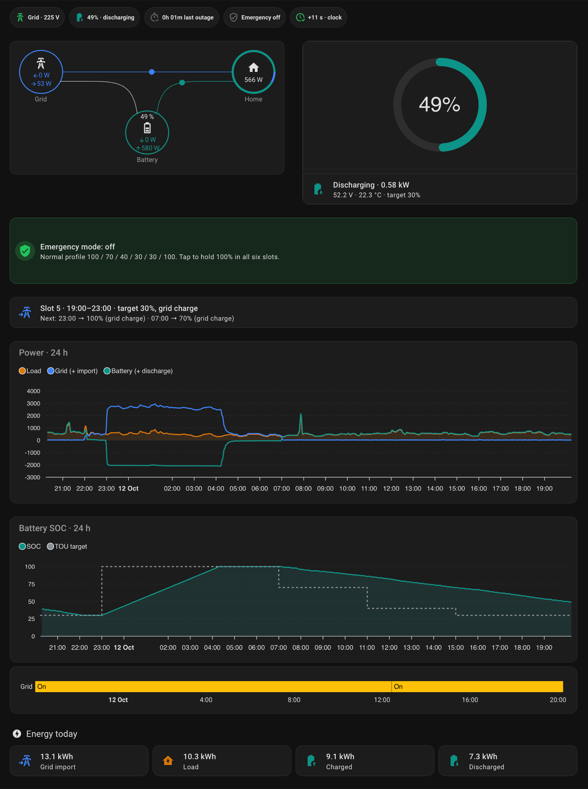
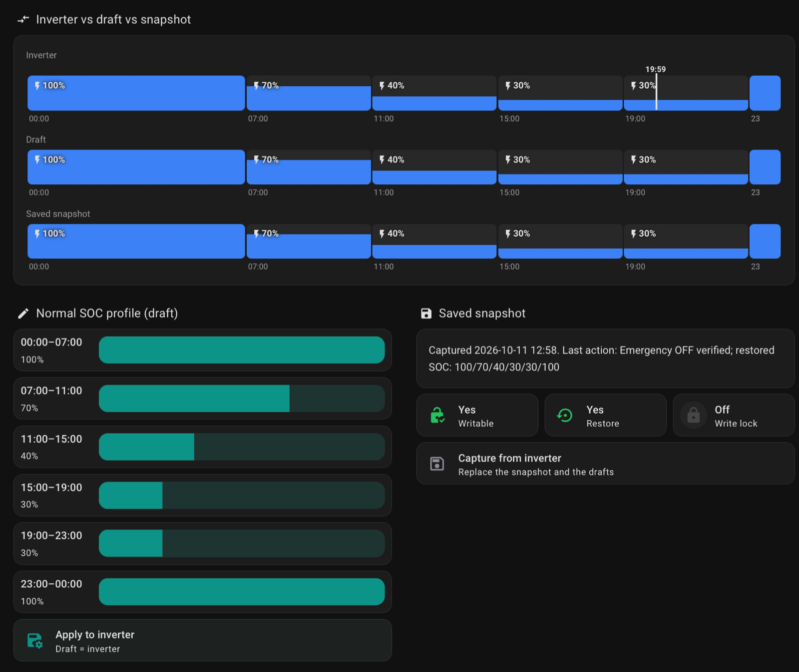
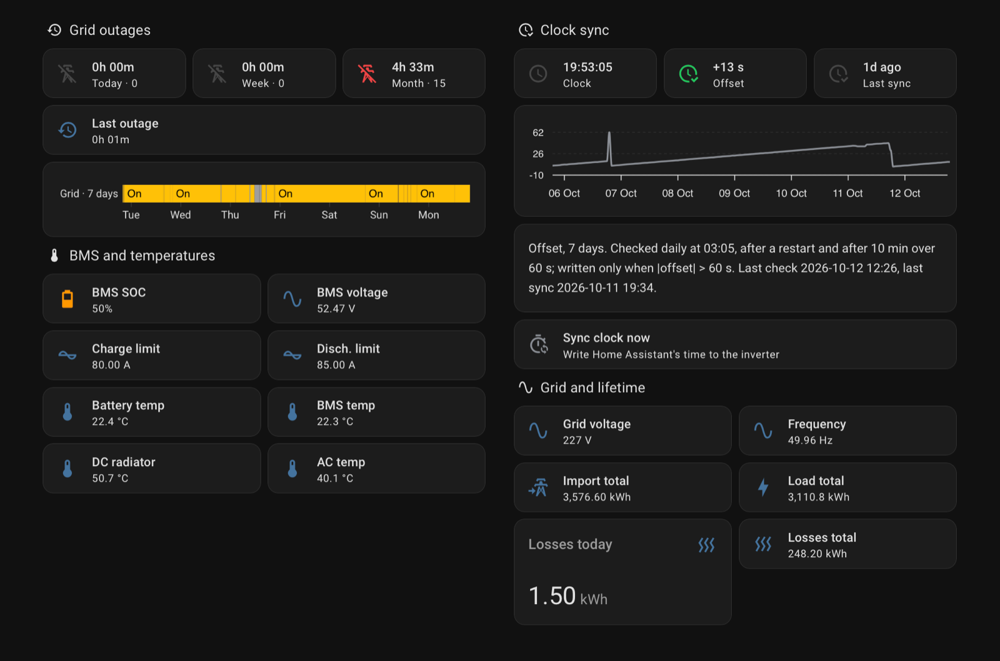
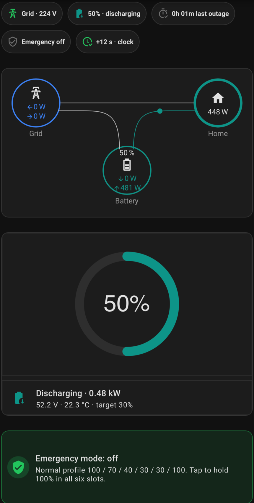

# ha-deye-modbus

Home Assistant YAML packages for a **Deye SUN-6K-SG05LP1-EU-AM2-P**
(6 kW single-phase hybrid) read over RS485 through an **Elfin EW11**
RS485-to-Modbus-TCP gateway, using only Home Assistant's core Modbus
integration. No custom components, no HACS integrations, nothing that
breaks when a third-party integration stops being maintained. (An
optional dashboard uses HACS frontend cards; the packages never need
them.)

Tested on one inverter. The register map was cross-checked against
public maps and then verified register by register with `mbpoll`; the
gotchas below are what that verification turned up.

## Gotchas

The main value of this repository. Each one cost real debugging time.

### The inverter ignores function 0x06

A plain `modbus.write_register` with a single number sends function
0x06 (write single register), which this inverter silently ignores.
Always pass a **list**, even for one register (`value: [70]`), so Home
Assistant sends 0x10 (write multiple registers).

### HA addresses are 0-based, mbpoll is 1-based

`address: 268` in Home Assistant is `mbpoll -r 269`. Mixing the two
shifts every reading by one register. All docs here give both.

### A failed write does not fail the action

When a Modbus write fails (timeout, no connection, exception reply),
Home Assistant logs `Pymodbus: ... Error` and the action returns
normally; the script carries on [HA core source, `modbus.py`]. The only
reliable signal is reading the registers back. Every write in this
project is followed by a read-back check.

### Read and write the clock as one block

Registers 22-24 hold year/month, day/hour, minute/second. Read them as
three separate sensors and they come from slightly different moments:
at every hour boundary the decoded time was off by an hour, and the
"offset" jumped to about 3600 s. Read all three in one request
(`structure: ">3H"`), compute the new time from **one** `now()`, and
write all three in **one** 0x10 request.

### DST: the daily sync runs before the switch

A daily clock check at 03:05 runs *before* the autumn switch at 04:00,
so the inverter would run an hour off — and shift every TOU slot by an
hour — until the next day. This project also syncs when the offset has
stayed over 60 s for 10 minutes, at most once per hour. (On 2026-10-25
the 03:05 check also ran in the repeated hour, at 03:05 winter time,
and corrected the clock there; the drift trigger stays as the safety
net.)

Right after a correct write inside the repeated hour 03:00-04:00, the
inverter time is ambiguous and reads as summer time: the offset shows
a phantom +3600 s until 04:00. The sync accepts about 0 or about
±3600 s. Its read-back must also be fresh: on that night a read-back
taken too soon after the write returned the pre-write offset and sent
a false "could not be verified" warning, so it now requires a read
newer than the write and retries once.

### Lifetime counters are 32-bit, low word first

Battery charge/discharge and load totals are 32-bit with the **low**
word in the first register (`data_type: uint32`, `swap: word`).

### Grid import total is 32-bit, but not contiguous

The grid import counter has its low word in register 78 and its high
word in register **80**. Register 79 between them is grid frequency
(values like 5001 = 50.01 Hz). Reading 78 as `uint32` glues the
frequency on as the high word.

Core Modbus cannot combine non-contiguous registers, so 78-80 are read
in one request with `structure: ">HxxH"` (the pad bytes skip 79) and a
template sensor computes `(high * 65536 + low) * 0.1`.

### The 16-bit grid import register wraps at 6553.5 kWh

Read on its own, register 78 is a 16-bit counter in 0.1 kWh steps, so it
wraps at 65535 = **6553.5 kWh**. The test install read 3473.6 kWh on
2026-10-06 (53% of the range); at roughly 15 kWh/day of grid import a
16-bit-only sensor would wrap in about 200 days. Lifetime counters that
look fine today can still be 16-bit; check the high word.

The template sensor also has an availability guard: an all-zero read
becomes a gap instead of a "meter reset", which would otherwise make the
Energy dashboard count the whole lifetime total a second time.

### Register 175 is inverter power, not load

Register 175 is often labelled "total power" and used as house load. It
is the **inverter's** power, negative while the inverter draws AC to
charge the battery. House load is register **178**. Measured while
charging from the grid: grid 2645 W, inverter -2084 W, load 561 W;
grid = load − inverter exactly.

Signs: grid power positive = import; battery power positive =
discharge, negative = charge.

### Detect outages with register 194, not the AC voltage

The AC voltage (register 150) can hold its last value while the grid is
down. Register 194 ("grid connected", the inverter's grid relay) drops
to 0 instantly and, when the grid returns, stays 0 for about 70 s while
the inverter checks grid stability. A 5 s poll cannot miss an outage,
and outage durations include that minute of reconnect time.

### A restart resets `last_changed`

Measuring an outage as "now minus when the sensor went off" breaks as
soon as Home Assistant restarts mid-outage: the sensor comes back with
a fresh `last_changed`. A 3h25m outage was once reported as 0h54m. The
outage start is now stored in restored helpers, set once per outage;
verified live on 2026-10-12 with a restart in the middle of an outage.

### TOU registers: four blocks, and the power block is easy to shift

| Block | HA addresses | mbpoll (1-based) |
|---|---|---|
| Start time (HHMM) | 250-255 | 251-256 |
| Power (W) | **256**-261 | 257-262 |
| SOC target (%) | 268-273 | 269-274 |
| Grid-charge flags | 274-279 | 275-280 |

The power block starts at 256, directly after the start times. Mapping
it one register late shifts every slot by one, which goes unnoticed
while all six slots hold the same power. Verify block mappings by
setting six *distinct* values on the inverter LCD; a read-back after a
write cannot catch a shift, because it reads the same wrong addresses.

### Grid-charge flags are a bit field

Registers 274-279 read 5 with the LCD "Grid" box ticked and 4 without.
That is not an on/off code. The bit layout comes from the kellerza/sunsynk
single-phase map: bits 0-1 are the charge source (1 = grid), bits 2-4
the slot mode (4 = "General"). Only 4 and 5 were observed here; the LCD
test of the other bits (the "Gen" box) has not been done. Test bit 0,
not `== 5`.

### `initial:` disables restore_state

An `input_number` or `input_text` with `initial:` is reset to that value
on **every** restart. A saved TOU snapshot defined that way silently
went back to its YAML defaults after each restart, while its "valid"
flag (no `initial:`) stayed on — so "restore" wrote the defaults. Use
`initial:` only where a reset on restart is the point (a startup grace
flag).

### One file for all Modbus sensors

Each `modbus:` entry creates a hub, and packages do not merge hubs. A
second entry with the same hub name **or the same host:port** passes
the configuration check but is **not loaded, with all its sensors**;
the only trace is a Repairs issue ("... is duplicate, not loaded!")
[HA core source, `modbus/validators.py`]. Every Modbus sensor lives in
`deye_modbus.yaml`; the other packages only add templates.

### Moving an entity to another platform keeps its statistics only by hand

The entity registry keys entries on (domain, platform, unique_id), so a
template sensor cannot take over a Modbus sensor's entry even with the
same `unique_id`. The tested procedure — remove, delete the orphan, add
the template on the freed entity id — is in
[docs/migration.md](docs/migration.md).

## What it provides

Core (`packages/`):

| File | Content |
|---|---|
| `deye_modbus.yaml` | Hub `deye_elfin`, every Modbus sensor, 32-bit grid import |
| `deye_clock.yaml` | Decoded clock, offset, sync script, automatic sync (daily, startup, drift/DST) |
| `deye_tou.yaml` | TOU schedule, read-only: times, power, grid-charge flags, active slot and its SOC target |
| `deye_tou_control.yaml` | TOU SOC snapshot, Apply, Emergency 100% with write lock and read-back |
| `deye_notify.yaml` | The one notification script; edit its targets |

Optional (`packages/optional/`):

| File | Content |
|---|---|
| `deye_grid_outage.yaml` | Grid available, outage duration and statistics, lost/restored/low-SOC alerts |
| `deye_inverter_losses.yaml` | Inverter losses as an Energy dashboard device |
| `deye_pv_split.yaml` | Estimated PV1 / PV2 daily energy |

Dashboards:

- `dashboards/deye.yaml`: built-in cards only; the default.
- `dashboards/deye_hacs.yaml`: optional, HACS frontend cards; see
  [Optional HACS dashboard](#optional-hacs-dashboard).

Template logic tests: `tests/render_templates.py`; how to run them is
in [docs/testing.md](docs/testing.md#template-checks).

The project writes to the inverter in exactly two places: the clock
(22-24) and the six TOU SOC targets (268-273). Nothing else is ever
written. See [docs/registers.md](docs/registers.md).

## Hardware and wiring

What this install uses. **Verified** = checked on this install;
**public sources** = from manuals and other projects, not checked here.
Check your own inverter's manual: cable colours do not guarantee
function.

### Inverter side

- Use the RJ45 port labelled **"Modbus"**, not "Meter-485" and not
  "BMS".
- Pinout on this install (verified): pin 2 = 485_A, pin 1 = 485_B.
  Public sources also show RS485 on pins 7/8 on some units.

### Wiring on this install (verified)

| Inverter RJ45 | Wire | EW11 |
|---|---|---|
| Pin 2 (485_A) | orange | A+ (pin 5) |
| Pin 1 (485_B) | white-orange | B- (pin 6) |

- RS485 signal ground: not wired; the link works without it here. A
  likely reason (an explanation, not a measurement): the EW11 is
  powered from the inverter's 12 V output, so both share a common
  reference.
- No termination resistor on the RS485 line (short cable).

### EW11 power (verified)

From the inverter's RSD 12 V output: terminals 17 (+) / 18 (-) to EW11
VCC (pin 7) / GND (pin 8). The RSD 12 V output is meant for
rapid-shutdown devices; on this install it powers the EW11
continuously, check yours. The EW11 accepts 5-18 V DC (public sources:
EW11 spec).

### EW11 settings (verified)

| Setting | Value |
|---|---|
| Serial | 9600 baud, 8 data bits, no parity, 1 stop bit |
| Buffer size | 512 |
| Gap time | 50 ms |
| Flow control | Half Duplex |
| Protocol | Modbus (Modbus TCP <-> RTU conversion, not transparent) |
| Socket | TCP Server, local port 502, route Uart |
| Max Accept | 3 (Home Assistant and `mbpoll` can connect at the same time) |
| Timeout | 0 |

### EW11 network (verified)

The EW11 joins the home Wi-Fi as a client (STA mode). The router gives
it a fixed IP through a DHCP reservation; that IP goes into
`deye_modbus_host` in `secrets.yaml`.

### Modbus slave address

On the inverter LCD, **"Modbus SN"** is the Modbus slave address, not
the serial number. It must match `slave:` in the packages: 1 on this
install, used by every sensor in `deye_modbus.yaml` and by the write
scripts in `deye_clock.yaml` and `deye_tou_control.yaml`. Do not use 0.

## Quick start

Requirements: Home Assistant with packages enabled, and a Modbus TCP
endpoint for the inverter's RS485 port (see
[Hardware and wiring](#hardware-and-wiring)). The gateway is ready when
this prints the battery SOC:

```sh
mbpoll -m tcp -a 1 -t 4 -r 185 -c 1 -1 <gateway-ip>
```

1. Enable packages in `configuration.yaml`:
   ```yaml
   homeassistant:
     packages: !include_dir_named packages
   ```
2. Add the gateway address to `secrets.yaml`:
   ```yaml
   deye_modbus_host: 192.0.2.10
   ```
3. Copy the core files from `packages/` into the `packages/` folder of
   your Home Assistant configuration directory, plus any optional
   modules you want.
4. In `deye_notify.yaml`, fill in `notify_entities` and/or
   `notify_actions`. Left empty, messages appear as persistent
   notifications.
5. Developer tools -> YAML -> Check configuration, then restart.
6. Check that the clock offset is near 0 and the TOU schedule matches
   the inverter LCD.
7. Before using any TOU control: press **Capture** once. It saves the
   current SOC profile as the snapshot and fills the drafts. Until then
   Apply and Emergency are blocked.
8. Optional: paste `dashboards/deye.yaml` into a new dashboard's raw
   configuration editor.

If your Energy dashboard has solar or grid export configured, set the
PV and export counters in `deye_inverter_losses.yaml`; see its header.

## Optional HACS dashboard

`dashboards/deye_hacs.yaml` is a Sections dashboard for daily use:

- **Home**: status chips, animated power flow grid / battery / home
  with an SOC ring, one Emergency card (green off, red on, tap to
  switch, with confirmation), the current TOU slot and the next
  changes, 24 h power and SOC charts, energy today.
- **TOU**: inverter, draft and snapshot as 24 h bars (height = SOC
  target, blue = grid charge), draft sliders, Apply and Capture.
- **Diagnostics**: outage statistics with a 7-day grid timeline, clock
  sync, BMS and temperatures, lifetime counters.

It needs these HACS frontend cards:
[Mushroom](https://github.com/piitaya/lovelace-mushroom) 5.x (tested
with 5.2.3; 5.0 changed the template card),
[card-mod](https://github.com/thomasloven/lovelace-card-mod),
[stack-in-card](https://github.com/custom-cards/stack-in-card),
[power-flow-card-plus](https://github.com/flixlix/power-flow-card-plus)
and [apexcharts-card](https://github.com/RomRider/apexcharts-card).
It also needs the optional `deye_grid_outage.yaml` and
`deye_inverter_losses.yaml` packages. Paste it into a new dashboard's
raw configuration editor; the file header lists the colors and the
design notes.

### Screenshots

Home: status chips, power flow with the SOC ring, Emergency card, the
current TOU slot and the next changes, 24 h power and SOC charts (the
dashed line is the TOU target), grid availability, energy today.



TOU: inverter, draft and snapshot bars with slot start times and the
"now" line; draft sliders with the slot time ranges; snapshot and
write-safety status.



Diagnostics: outage statistics and the 7-day grid timeline, clock
sync, BMS and temperatures, lifetime counters.



Home on a phone:



## Verified on hardware

On the test install, 2026-10-06 unless noted. Procedures and raw
results: [docs/testing.md](docs/testing.md).

- Register 194 as outage signal: breaker test, 10-15 s outage, both
  alerts fired, ~70 s reconnect hold.
- A real grid outage (2026-10-07, about 18 minutes): "lost" and
  "restored" fired in the same minutes as the stock logger's alerts;
  duration 18 min here vs 18 min 30 s from the logger.
- A very short grid dip (2026-10-08): register 194 read 0 for about
  65-70 s, roughly the reconnect hold alone; "lost" and "restored" fired,
  as did the stock logger's alerts. The lights did not flicker. The
  dip's own length is unknown.
- Outage duration across a Home Assistant restart (2026-10-12): grid
  breaker off for about 3 minutes, Home Assistant restarted right after
  "lost"; no second "lost", and "restored" reported 0h 04m (the outage
  plus the ~70 s reconnect hold).
- Inverter losses daily value (2026-10-07): 1.6 kWh, about 11% of grid
  import, consistent with the measured charge conversion loss and a
  cross-check against the battery SOC balance.
- 32-bit counters (72/73, 74/75, 85/86) with mbpoll; grid import split
  78 + 80 with 79 = frequency.
- Single-request clock write (0x10, 3 registers).
- Drift/DST trigger: a +304 s offset was corrected about 10 minutes
  later.
- The autumn DST night (2026-10-25): offset about -3550 s right after
  the fall-back; one clock write at about 03:05 winter time; the
  phantom +3600 s until 04:00, then about 0; the inverter display shows
  the correct time. That night's read-back sent a false "could not be
  verified" warning; fixed since (see the DST gotcha). The fixed
  read-back passed a manual sync on 2026-10-28; its retry path is
  checked offline only.
- Register 175 = inverter power, 178 = load; grid and battery signs.
- TOU block mapping against the LCD.
- TOU snapshot survives restarts; Apply and Capture blocked during
  Emergency.
- Emergency ON/OFF full cycle with read-back; repeated from the HACS
  dashboard on 2026-10-11.
- Grid import migration to the 32-bit template sensor without losing
  Energy statistics.

## Not verified

- Register 194 on a dip of known sub-second length: the 2026-10-08 dip
  was caught, but how long it lasted was not measured. (The author still
  runs the stock logger alongside as a backup until this is confirmed.)
- Grid power sign during export (the test install never exports).
- Grid-charge flag values other than 4 and 5 (the bit layout is from
  the kellerza/sunsynk map; the LCD "Gen" box test is skipped on
  purpose: the test install has no generator).
- PV registers (the test install has no panels).
- Other LP1 models or firmware versions, and RS485-to-TCP gateways
  other than the EW11.

## Use at your own risk

These packages write to an inverter that powers a home. The writes are
narrow, locked and verified, but a wrong register on a different model
or firmware could change a setting you did not intend. Verify the map
on your own inverter with `mbpoll` first, and keep the inverter's LCD
within reach the first time you use a write.

## Credits and license

Register maps cross-checked against
[kbialek/deye-inverter-mqtt](https://github.com/kbialek/deye-inverter-mqtt)
and [kellerza/sunsynk](https://github.com/kellerza/sunsynk) (both
Apache-2.0); details in [NOTICE.md](NOTICE.md). This project: MIT, see
[LICENSE](LICENSE).
